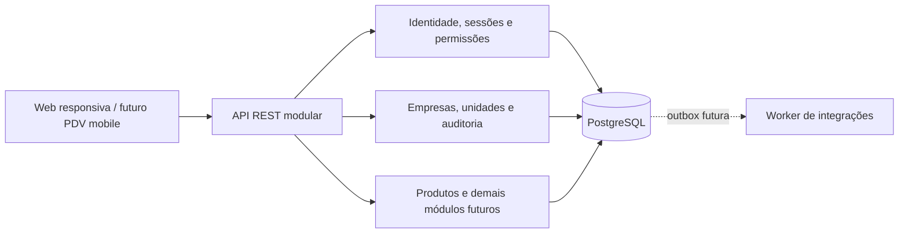

# Arquitetura proposta

Status: proposta inicial, anterior à programação. Data: 09/11/2026.

## Ambiente observado

| Item | Evidência |
| --- | --- |
| Diretório | `C:\Users\tiago\OneDrive\Documentos\ChatGPT\ERP COMERCIO` |
| Sistema / shell | Windows / PowerShell |
| Repositório | Inicializado, branch original `master`, sem commits e sem remoto |
| Código / banco / arquitetura existente | Ausentes no diretório |
| Node.js | `v26.13.0` retornado pelo executável instalado |
| npm | `11.20.0` retornado por `npm.cmd --version` |
| Docker / PostgreSQL | `docker` e `psql` não encontrados no PATH; não foi feita inspeção de serviços ou instalações fora do PATH |
| Instruções locais | Nenhum `AGENTS.md` encontrado no projeto ou nos ancestrais verificados |

Não foi inspecionado o estado de serviços de outros projetos. Ausência de configuração no repositório não significa ausência de serviços no computador.

## Decisão inicial

Monólito modular com web e API separadas no mesmo workspace npm. Uma API centraliza regras, autorização e transações para desktop e celular. Sem microsserviços nesta fase. A divisão reduz complexidade operacional e preserva limites entre módulos.

| Camada | Proposta | Motivo |
| --- | --- | --- |
| Web | Next.js, React, TypeScript | Interface responsiva e estrutura compartilhada |
| API | NestJS, TypeScript, REST `/api/v1` | Módulos, validação de entrada e autorização centralizada |
| Banco | PostgreSQL | Transações, restrições relacionais, decimais e RLS |
| Persistência | SQL versionado e `pg` com consultas parametrizadas | Controle explícito de políticas RLS e contexto transacional |
| Contratos | Pacote TypeScript com esquemas de validação | Reduz divergências entre cliente e servidor |
| Verificação | Testes unitários, integração com PostgreSQL e Playwright | Verifica regras, isolamento real e uso responsivo |
| Processamento futuro | Outbox transacional e worker | Entrega recuperável de eventos e notificações |

Versões exatas e bibliotecas de sessão, senha, validação e MFA serão fixadas no bootstrap após verificar compatibilidade e manutenção. O Node encontrado não define automaticamente a versão de produção. Nenhuma dependência foi instalada nesta entrega.



## Organização prevista

```text
apps/
  web/                  # login, seleção de contexto e administração responsiva
  api/src/modules/
    identity/           # login, MFA, recuperação e sessões
    tenancy/            # empresas contratantes e vínculos
    organizations/      # empresas legais, matriz, filiais e depósitos
    access/             # papéis e permissões
    audit/              # eventos auditáveis
packages/contracts/     # esquemas e tipos de API
database/migrations/    # SQL incremental, restrições e políticas
database/seeds/         # fixtures exclusivamente de desenvolvimento/teste
tests/integration/
tests/e2e/
docs/
```

## Modelo de identidade e organização

`tenant` representa o cliente contratante e é a fronteira de isolamento. `legal_entity` representa uma pessoa jurídica dentro desse cliente; `unit` representa matriz, filial ou centro de distribuição. `warehouse` representa depósito de uma unidade. Uma rede pode conter vários CNPJs, sem misturar documentos fiscais.

Entidades da fundação: `users`, `sessions`, `mfa_credentials`, `recovery_tokens`, `tenants`, `memberships`, `legal_entities`, `units`, `warehouses`, `roles`, `permissions`, `role_permissions`, `membership_roles`, `membership_units` e `audit_events`.

Identidade global contém somente o necessário para autenticar. Os dados comerciais e os vínculos pertencem ao tenant. Uma pessoa poderá participar de dois clientes por vínculos explícitos, cada um com permissões próprias. Papéis do Master não serão herdados por contas comerciais.

## Isolamento obrigatório

1. Validar sessão e vínculo ativo; a seleção de empresa enviada pelo navegador nunca concede acesso.
2. Validar permissão e escopo de unidades em toda operação, inclusive consultas por ID, relatórios, exportações e tarefas de fundo.
3. Toda tabela de negócio contém `tenant_id` obrigatório. Referências entre entidades usam chaves compostas por tenant e ID; unicidade comercial é definida no escopo adequado.
4. Executar acesso a negócio em transação com contexto local de tenant, usuário e escopo autorizado. Conexões do pool não retêm contexto entre requisições.
5. Aplicar RLS com `USING` e `WITH CHECK`, negação quando contexto estiver ausente e papel de execução sem superusuário, propriedade das tabelas ou `BYPASSRLS`. Usar `FORCE ROW LEVEL SECURITY` nas tabelas protegidas.
6. Separar papel de migração do papel de execução. Testar políticas com o papel real da API, incluindo tentativas de INSERT/UPDATE cross-tenant.
7. Escopar chaves de cache, arquivos, jobs e idempotência por tenant. Unidades devem pertencer à empresa legal e ao tenant selecionados.

Consultas de identidade global terão acesso mínimo e restrito a essa finalidade. Não usar conexões privilegiadas como atalho para consultas comerciais. O painel Master será desenvolvido em etapa posterior com operações explícitas e auditadas; sem bypass genérico disponível aos clientes.

## Autenticação e autorização

Sessões opacas com segredo aleatório, armazenado como hash no servidor, expiração, rotação e revogação. Cookie `HttpOnly`, `Secure` em HTTPS e política `SameSite`; proteção CSRF nas mutações e validação de origem. Não guardar sessão em `localStorage`.

Senhas com Argon2id em biblioteca mantida; limitação de tentativas e mensagens que não enumerem contas. Recuperação com token de uso único, hash persistido e expiração. Exigir MFA dos perfis sensíveis antes de conceder funções administrativas; validar inclusive recuperação e revogação.

Permissões por ação, com negação por padrão. Exemplos: `organizations.read`, `organizations.manage`, `users.invite`, `access.manage`, `audit.read`. Esconder um botão não substitui a verificação na API. Mudanças de permissão devem afetar sessões existentes sem depender apenas de claims antigos.

Convites vinculam empresa e permissões; não haverá autocadastro público criando administradores. Bootstrap inicial por procedimento local explícito, sem senha padrão em seed ou código. Integração de e-mail ficará atrás de adaptador; testes usam transporte em memória, produção dependerá de provedor.

## Transações, auditoria e evolução comercial

Alteração de negócio e evento de auditoria devem ser confirmados na mesma transação. Eventos registram tenant, unidade quando aplicável, ator, ação, entidade, instante UTC e correlação. A conta de execução não atualiza nem apaga eventos; dados sensíveis são removidos do payload. Auditoria não equivale a armazenamento inviolável: retenção e arquivamento externo serão definidos antes de produção.

Módulos futuros usarão valores `numeric` no banco e representação decimal exata no domínio; valores monetários não dependem de ponto flutuante binário. Vendas, pagamentos e estoque exigirão idempotência, locks/controle de concorrência e estornos rastreáveis. Autorização de pagamento não será tratada como confirmação.

Datas de eventos são persistidas em UTC e apresentadas conforme fuso da unidade. Operação offline, filas externas, integrações fiscais, pagamentos e IA não fazem parte da Etapa 01. Câmera e service worker entram na etapa de PDV; cache não deve expor dados de sessões anteriores.

## Operação e interface

Implantação prevista com HTTPS e web/API sob mesma origem, banco privado, migrações controladas, backups e ensaio de restauração. Infraestrutura final, metas de recuperação e observabilidade permanecem pendentes. Nenhuma publicação é autorizada pelo planejamento.

Interface usa preto, branco e ouro; texto com contraste adequado, foco de teclado, rótulos de formulário e mensagens de erro. Desktop com menu lateral e seleção de contexto; celular com navegação compacta. A fundação terá login, seleção de empresa/unidade, gestão de usuários/unidades e estado inicial sem indicadores inventados.

## Referências técnicas consultadas

- [PostgreSQL — políticas RLS](https://www.postgresql.org/docs/18/ddl-rowsecurity.html): isolamento e condições de bypass; `FORCE` não restringe superusuário ou papel `BYPASSRLS`.
- [NestJS — autorização](https://docs.nestjs.com/security/authorization): suporte à implementação de autorização na API.
- [Next.js — instalação](https://nextjs.org/docs/app/getting-started/installation): requisitos a conferir ao fixar dependências.

As escolhas acima são decisões propostas para este projeto, não exigências dessas fontes.
